# Roost

**Every conversation comes home.**

Roost is a macOS app that puts your email, calendar and chat apps in one window. Gmail and Google Calendar run inside Roost. WhatsApp, Slack, Telegram, Discord and Messenger sit next to them. Each app keeps its own private storage, so you can stay signed in to many accounts at once.

> Name note: other software also uses the name "Roost". This project is unrelated to them.


*All screenshots use made-up data from the test server. No real accounts.*

## Screenshots

| | |
| --- | --- |
| 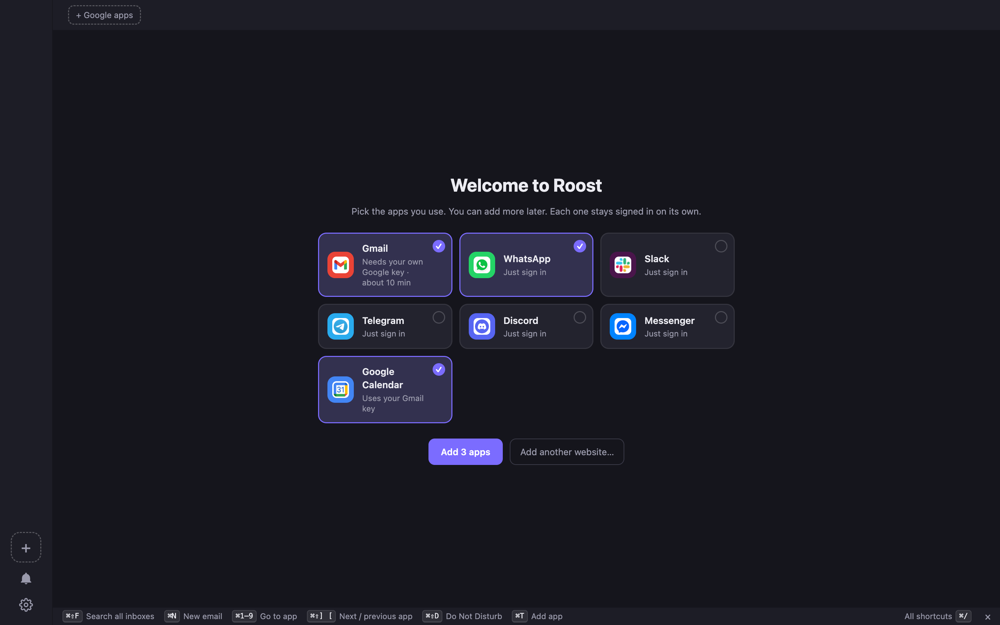 | 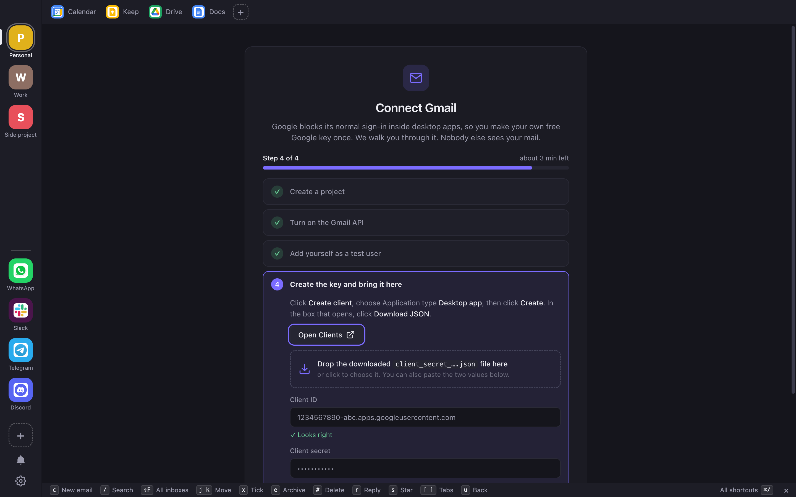 |
| **Welcome** — pick your apps, add them in one click | **Connect Gmail** — 4 steps, drop the key file |
| 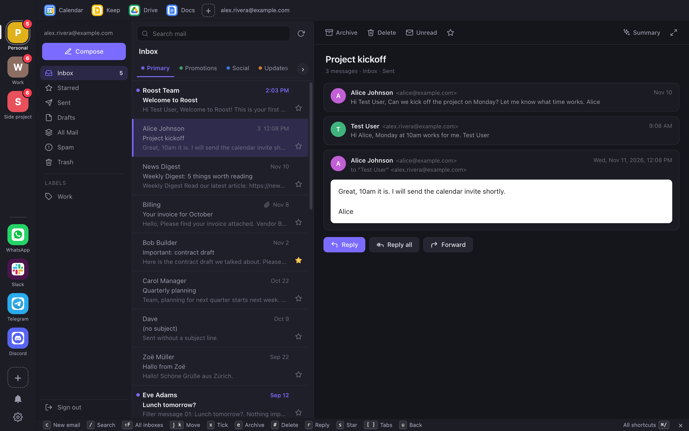 | 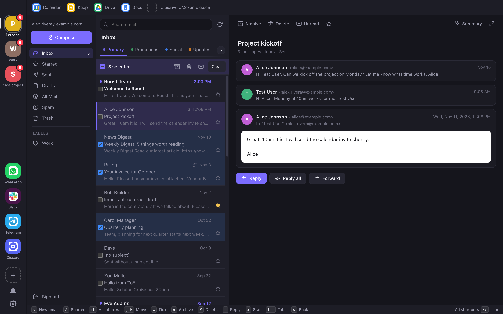 |
| **Inbox** — tabs, open conversation, top bar, shortcut bar | **Act on many** — tick emails, then archive or delete |
| 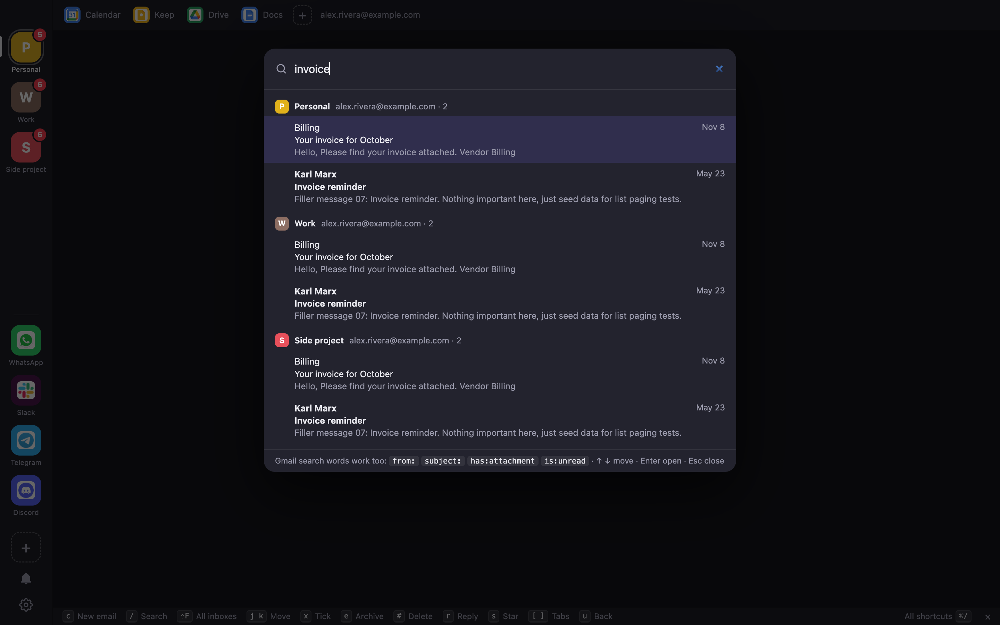 | 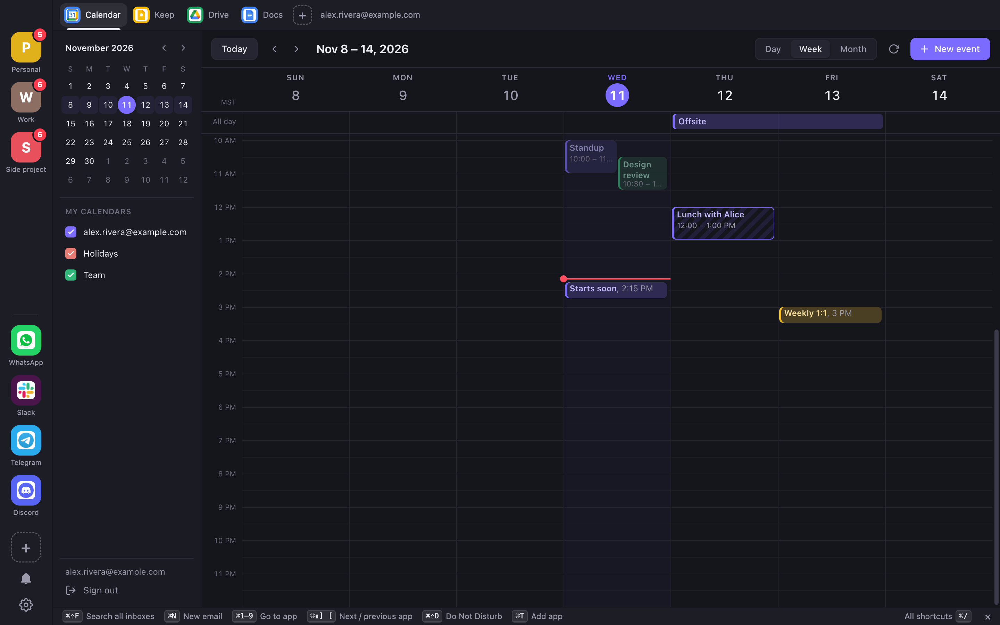 |
| **Search all inboxes** (⌘⇧F) | **Google Calendar** inside Roost |
| 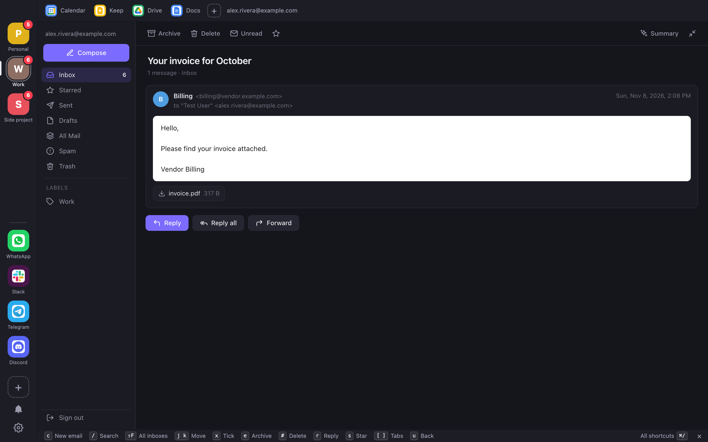 | 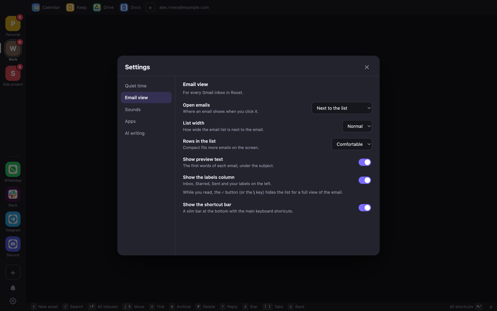 |
| **Full view** — hide the list with ⤢ or `\` | **Settings › Email view** |
| 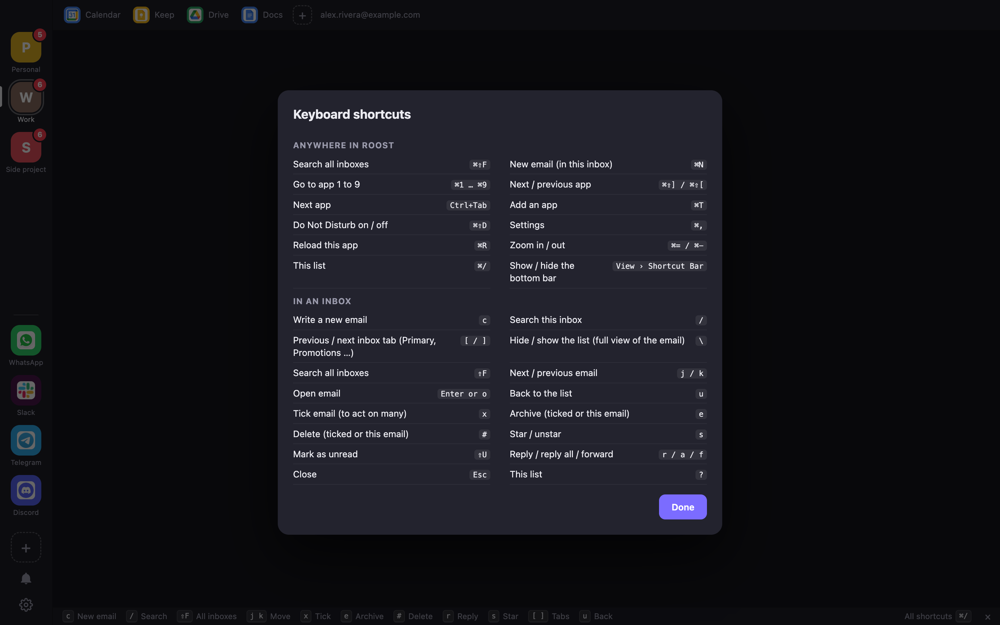 | 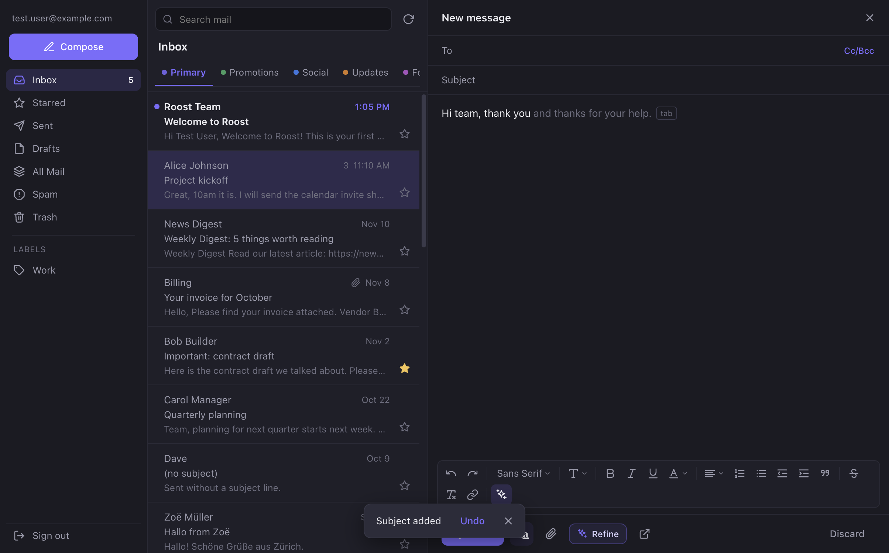 |
| **Keyboard shortcuts** (⌘/) | **Compose** — formatting bar, Smart Compose (Tab to accept) |
| 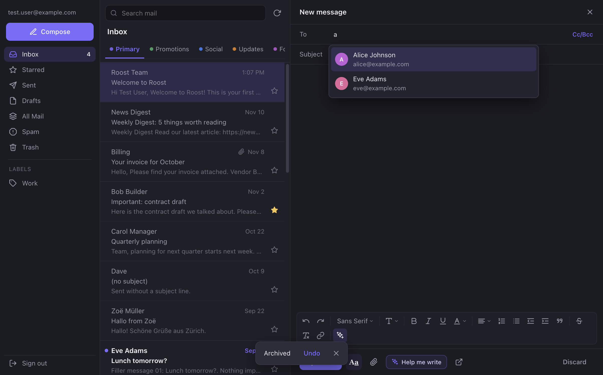 | 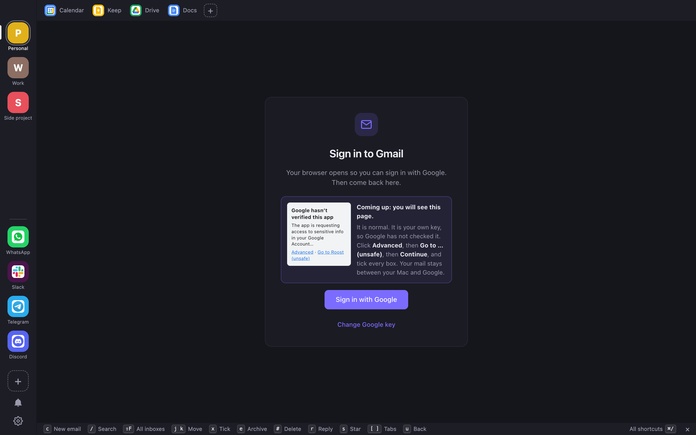 |
| **Autofill** — pick people you write to | **Sign in** — what Google will show, before it shows it |
| 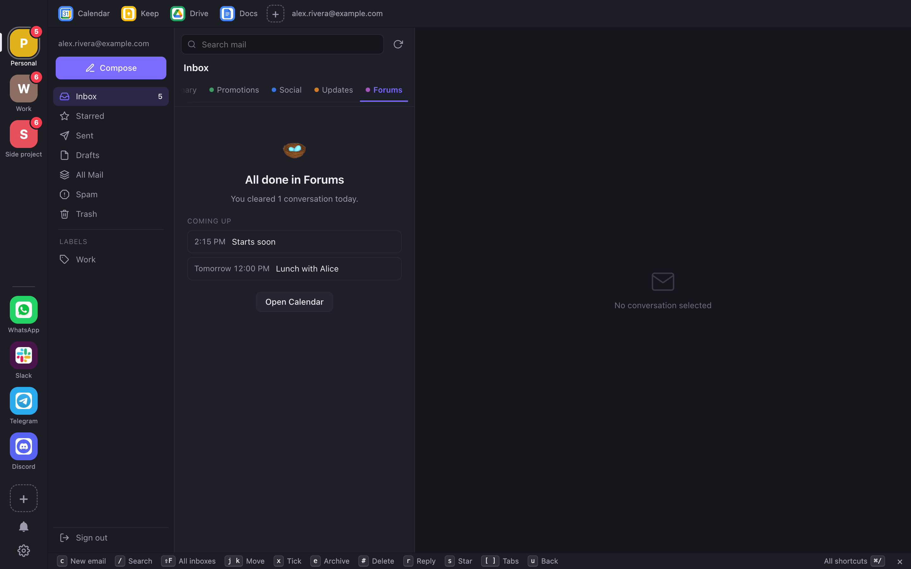 | |
| **All done** — cleared today, and what is coming up | |

To make them again: `npm run screenshots` (needs ffmpeg for the tour).

## What you get

- **One window.** A left sidebar holds your email inboxes (top) and your messenger apps (bottom). A top bar holds Google Calendar, Keep, Drive and Docs.
- **Easy start.** Pick your apps from tiles on the welcome screen. Connecting Gmail is a 4-step guide: drop the Google key file and Roost fills in the rest.
- **Gmail inside Roost.** Uses Google's official Gmail API. Inbox tabs (Primary, Promotions, Social, Updates, Forums), search, read, reply, reply all, forward, compose, archive, delete (with Undo), star. Tick boxes to act on many emails at once.
- **Calm badges.** Red numbers count mail in your Primary tab and chats from people. Other unread mail shows a gray number.
- **A Gmail-style composer.** Rich text with the same formatting bar as Gmail: font, size, bold, italic, underline, text and background color, align, lists, indent, quote, strikethrough, remove formatting and links. Emails are sent as HTML plus a plain text copy. Recipient autofill suggests people from your own Sent and Inbox mail (no extra Google permission).
- **Google Calendar inside Roost.** Uses Google's Calendar API.
- **Many accounts.** Add Gmail, WhatsApp and the others more than once. Each one is separate.
- **Search all inboxes** at once (⌘⇧F).
- **Quiet time.** Do Not Disturb (⌘⇧D), quiet while you are on a call, and quiet hours.
- **Email view your way.** Open emails next to the list, under the list, or full screen. Compact rows, preview text, labels column.
- **Optional AI help** with your own Claude key: Smart Compose (gray suggestions as you type, Tab to accept), Help me write, refine, smart replies, summaries. Google's own Gemini features are not available to other apps, so Roost uses Claude. The ↗ button in compose opens the draft in Gmail if you want Gemini.
- **Your own icons.** Right-click a tile > Icon > App Icon, First Letter or Choose Picture.
- **Private by design.** No Roost server. See [Privacy and security](#privacy-and-security).

## Quick start

You need a Mac with Apple Silicon, Node.js 20+ and Xcode Command Line Tools. Details are in [docs/INSTALL.md](docs/INSTALL.md).

```bash
git clone https://github.com/sylphdesign/roost.git
cd roost
npm install
npm start
```

To build the app you can keep in /Applications:

```bash
npm run pack
```

This makes `dist/mac-arm64/Roost.app`. Copy it to `/Applications`.

Then connect Gmail. Roost needs a free Google key that you make yourself. Follow [docs/GOOGLE_SETUP.md](docs/GOOGLE_SETUP.md). It takes about 10 minutes.

## Docs

- [docs/INSTALL.md](docs/INSTALL.md) - requirements, build, first run
- [docs/GOOGLE_SETUP.md](docs/GOOGLE_SETUP.md) - make your Google key, step by step
- [docs/PERMISSIONS.md](docs/PERMISSIONS.md) - every prompt macOS and Google will show, and what to click
- [CHANGELOG.md](CHANGELOG.md) - what changed
- [SECURITY.md](SECURITY.md) - report a problem, what is stored where
- [CONTRIBUTING.md](CONTRIBUTING.md) - help build Roost

## Keyboard shortcuts

Press ⌘/ in Roost to see the list.

| Keys | What it does |
| --- | --- |
| ⌘⇧F | Search all inboxes |
| ⌘N | New email |
| ⌘1 to ⌘9 | Go to app 1 to 9 |
| ⌘⇧] / ⌘⇧[ | Next / previous app |
| Ctrl+Tab | Next app |
| ⌘T | Add an app |
| ⌘⇧D | Do Not Disturb on/off |
| ⌘, | Settings |
| ⌘R | Reload the app |
| ⌘= / ⌘- | Zoom in / out |
| ⌘/ | Show the shortcut list |

Inside an inbox:

| Key | What it does |
| --- | --- |
| c | Compose |
| / | Search |
| ⇧F | Search all inboxes |
| [ and ] | Previous / next tab |
| j / k | Next / previous email |
| Enter or o | Open email |
| u | Back to list |
| x | Tick the email |
| e | Archive |
| # | Delete |
| s | Star |
| ⇧U | Mark unread |
| r / a / f | Reply / reply all / forward |
| \ | Hide or show the list |
| Esc | Close |
| ? | Show shortcuts |

While you write an email:

| Keys | What it does |
| --- | --- |
| Tab or → | Accept the Smart Compose suggestion |
| ⌘B / ⌘I / ⌘U | Bold / italic / underline |
| ⌘K | Insert link |
| ⌘⇧7 / ⌘⇧8 | Numbered / bulleted list |
| ⌘⇧9 | Quote |
| ⌘] / ⌘[ | Indent more / less |
| ⌘⇧X | Strikethrough |
| ⌘⇧L / ⌘⇧E / ⌘⇧R | Align left / center / right |
| ⌘\ | Remove formatting |
| ⌘Enter | Send |
| ↑ ↓ then Enter or Tab | Pick a suggested recipient |

## Privacy and security

- Roost has **no server**. There is no Roost account and no tracking.
- You make your **own** Google OAuth key. Roost talks to Google directly with it.
- Google tokens stay on your Mac, encrypted with the macOS Keychain (Electron `safeStorage`).
- Nothing leaves your Mac except calls to Google, and to Anthropic only if you add a Claude key. Then Anthropic gets the text you ask about when you click an AI button, and, while Smart Compose is on, the draft you are typing (plus the conversation you reply to) each time you pause. Turn Smart Compose off with the ✨ button on the formatting bar.
- Roost never sees your Google password. Sign-in happens in your browser on Google's own page.

More in [SECURITY.md](SECURITY.md).

## Project layout

```
src/
  main.js              window, menus, settings, one view per app, notifications
  presets.js           built-in app types (Gmail, WhatsApp, Slack ...)
  gmail-api.js         Gmail API client and Google sign-in (loopback + PKCE)
  google-calendar.js   Google Calendar API client
  gmail/               the Gmail screen (HTML, CSS, JS)
  calendar/            the Calendar screen (HTML, CSS, JS)
  ui/                  sidebar, top bar, Settings, Add app dialog
  ai.js                optional Claude helpers (Smart Compose, Help me write, summaries)
  chrome-bridge.js     opens Keep, Drive and Docs in a private Chrome window
  preload-service.js   runs inside each app: unread counts, notification rules
  preload-ui.js        bridge for the sidebar UI
  store.js, unread.js  small helpers
native/mic-watch.c     detects when the microphone is in use (quiet during calls)
scripts/make-icons.js  redraws the app icons
test/                  unit tests and end-to-end tests with a fake Google server
```

## Tests

```bash
npm test          # unit tests (node --test)
npm run test:all  # unit tests plus every app test (test/*.e2e.js)
```

The app tests start the real Electron app against a fake Google server (`test/fake-gmail-server.js`). They need a display and take a few minutes. No real accounts or keys are used.

## License

[MIT](LICENSE). Copyright (c) 2026 sylphdesign.
